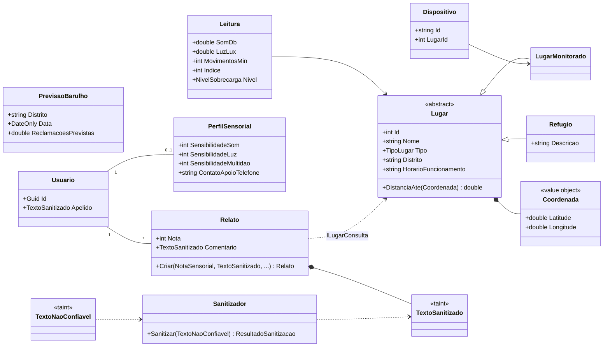
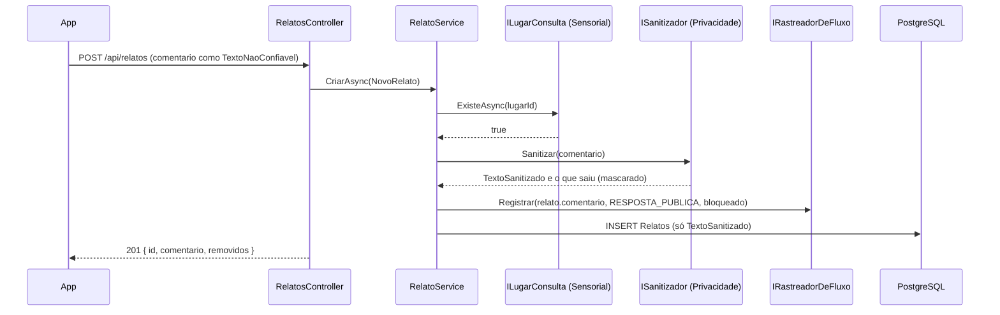
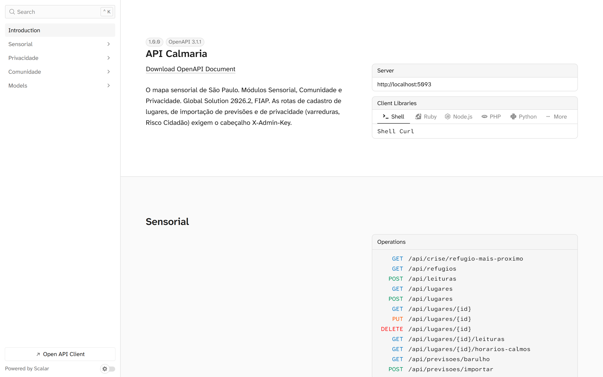

# API Calmaria

A API em C# (.NET 10) que atende três disciplinas da GS: C# Software Development, SOA e Web Services e
Cybersecurity. Três módulos que só conversam por interface: **Sensorial** (lugares, leituras, índice, crise),
**Comunidade** (perfil anônimo e relatos) e **Privacidade** (dado sensível, taint, Risco Cidadão). O plano
completo está em `docs/disciplinas/csharp.md`; a Ficha da CitizenTech, no [README da raiz](../README.md).

**Integrantes (3ESPW):** Guilherme Almeida (RM 555180), Luiz Gustavo da Silva (RM 558358), Rafael Duarte de
Freitas (RM 558644), Rafael Gaspar Bragança Martins (RM 557228) e Vinicius Monteiro Araújo (RM 555088).

## Estado (17/11)
Os três módulos completos. A parte de Cybersecurity (varreduras, tradução por IA, Risco Cidadão, painel, Semgrep e
a Auditoria do Protótipo) está explicada em [security/README.md](../security/README.md).

| Rota | O que faz |
|---|---|
| `GET /api/lugares` | Lugares perto (`lat`, `lng`, `raioM`, `tipo`), com o nível de agora (leitura dos últimos 15 min) |
| `GET /api/lugares/{id}` | Um lugar com a última leitura |
| `POST /api/lugares`, `PUT` e `DELETE /api/lugares/{id}` | Cadastro (uso da equipe, exige `X-Admin-Key`); lugar com sensor ou relato não se apaga (409) |
| `GET /api/lugares/{id}/leituras` | Histórico (`desde`; padrão: últimas 24 horas) |
| `GET /api/lugares/{id}/horarios-calmos` | As 3 horas mais calmas da semana e a grade de médias (28 dias, horário de São Paulo) |
| `POST /api/leituras` | Ingestão por HTTP, no formato da mensagem MQTT (201, 404, 422) |
| `GET /api/crise/refugio-mais-proximo` | O refúgio fixo ou o lugar CALMO agora mais perto, com minutos a pé e o trajeto |
| `GET /api/refugios` | Os refúgios fixos, para o app guardar e usar sem internet |
| `GET /api/previsoes/barulho` | Previsão do ML por distrito (`dias` ou `data`) |
| `POST /api/previsoes/importar` | Importa o CSV do ML (exige `X-Admin-Key`) |
| `POST /api/usuarios` | Usuário anônimo (só um id; apelido opcional, sanitizado) |
| `GET`, `PUT /api/usuarios/{id}/perfil-sensorial` | Sensibilidade a som, luz e multidão (1 a 5) e o contato de apoio |
| `DELETE /api/usuarios/{id}` | Apaga o usuário, o perfil e os relatos (LGPD, art. 18) |
| `POST /api/relatos` | Relato de visita; o comentário é sanitizado antes de gravar e a resposta diz o que saiu (409 se repetido em 30 min) |
| `GET /api/relatos` | Relatos públicos, paginados, **sem o autor**, com o filtro da resposta pública |
| `GET /api/lugares/{id}/resumo-relatos` | Nota média e gatilhos mais citados |
| `POST /api/privacidade/analisar` | O que seria removido de um texto, mascarado; nada é gravado |
| `POST /api/privacidade/varreduras` | Varre logs, relatos, broker MQTT e código; calcula o Risco Cidadão (exige `X-Admin-Key`) |
| `GET /api/privacidade/risco-cidadao`, `/achados`, `/fluxos` | Indicador com antes e histórico, dados expostos e fluxos barrados (exigem `X-Admin-Key`) |
| `/seguranca` | O painel Risco Cidadão (HTML estático servido pela API; pede a chave) |
| `GET /health` | Banco e MQTT (`Healthy`; `Degraded` se o MQTT cair; `Unhealthy` se o banco cair) |
| `/scalar` | A documentação interativa, com os três módulos e exemplos prontos |

O **worker MQTT** assina `calmaria/v1/lugares/+/leituras` no `broker.hivemq.com`, grava cada leitura pelo mesmo
serviço do `POST /api/leituras` e reconecta sozinho. Mensagem inválida vai para o log com o motivo, nunca com o
conteúdo. Ligado em desenvolvimento (`Mqtt:Habilitado`); na VM, `Mqtt__Habilitado=true`.

Em desenvolvimento, com a tabela vazia, a API grava **4 semanas de leituras simuladas** dos 4 lugares
monitorados (semente fixa, a mesma base em qualquer computador).

**Privacidade, em três camadas.** (1) Pelo tipo: o texto do cidadão entra como `TextoNaoConfiavel` e só o
`Sanitizador` produz `TextoSanitizado`, o único que o relato grava e a resposta pública devolve; gravar, publicar
ou mandar ao LLM o texto cru não compila. (2) Na saída, em execução: o `LoggerProviderComRedacao` mascara toda
linha de log com dado pessoal e o `FiltroRespostaPublica` faz o mesmo nas rotas públicas; cada bloqueio vira um
fluxo no painel. (3) No código: as regras do Semgrep em `security/semgrep/`. Detalhes, números e evidências em
[security/README.md](../security/README.md).

**Rotas administrativas** exigem o cabeçalho `X-Admin-Key` igual a `Privacidade:ChaveAdmin` (user-secrets em
desenvolvimento; `Privacidade__ChaveAdmin` na VM). A comparação é em tempo constante.

São 241 testes: 137 da API e 104 do módulo de privacidade.

## Para a avaliação de SOA

| Critério | Onde está | O que mostrar |
|---|---|---|
| Estruturação do domínio (3,0) | `src/Calmaria.Domain/Sensorial/` (lugar, refúgio, dispositivo, leitura, índice, previsão) e `src/Calmaria.Domain/Comunidade/` (usuário, perfil, relato), com objetos de valor (`Coordenada`, `NotaSensorial`, `Sensibilidade`) e as regras dentro das entidades | O diagrama abaixo; uma regra barrando dado inválido: nota 6 (400), leitura de -10 dB (422), relato repetido (409) |
| Conexão com banco (3,0) | PostgreSQL com EF Core e Npgsql em `src/Calmaria.Infrastructure/Persistencia/`: herança numa tabela (TPH), 1:1 (usuário e perfil), 1:N com cascata (usuário e relatos), restrição (lugar com relato), índices | `\dt` no `psql`; a conexão vem de `ConnectionStrings__Calmaria`, nunca do código |
| Migrações (1,5) | Uma por módulo em `src/Calmaria.Infrastructure/Persistencia/Migracoes/`: `Inicial_Sensorial`, `Comunidade` e `Privacidade`; o `efbundle` que a VM aplica | `dotnet ef migrations list` e o banco criado do zero |
| Documentação automática (1,5) | OpenAPI gerado pelo código (comentários XML e `[ProducesResponseType]` em cada status), Scalar em `/scalar` com os três módulos, exemplos e o tema da Calmaria (`src/Calmaria.Api/Comum/DocumentacaoOpenApi.cs` e `TemaDoScalar.cs`) | Um endpoint testado no próprio Scalar |
| Testes automatizados (1,0) | `tests/Calmaria.Tests` (domínio e endpoints com `WebApplicationFactory` e SQLite em memória) e `tests/Calmaria.Privacidade.Tests` (MSTest) | `dotnet test` com 241 testes |
| Chamada a API REST | O `TradutorLlm` chama o LLM por `HttpClient` tipado com tempo limite, nova tentativa e disjuntor (`Microsoft.Extensions.Http.Resilience`) e cai na frase pronta se o serviço falhar; testado com um serviço simulado (resposta certa, erro 500, 401, sem rede, resposta fora do formato) | O alerta no painel `/seguranca`, que diz se veio do LLM ou da frase pronta, e por quê |

**Onde está a orientação a serviços.** Os três módulos têm fronteira e contrato: cada um tem os próprios
controllers, serviços, tabelas e migração, e só conversam por interface (`ILugarConsulta`, `ISanitizador`,
`IRastreadorDeFluxo`). Os contratos estão publicados: o OpenAPI com o app, o tópico e o payload MQTT com o ESP32 e o
CSV de previsões com o ML. A integração com o sensor é assíncrona, por mensagem: o ESP32 publica no broker e a API
assina, sem um conhecer o outro. O LLM é consumido como serviço externo, com resiliência. Qualquer módulo pode virar
um serviço separado trocando só a implementação da interface (o plano B em `docs/disciplinas/soa-web-services.md`).

### Diagrama de classes do domínio



### Diagrama de sequência de um relato



## Evidências

Em `docs/evidencias/`, geradas de execuções reais por `node entrega/gerar-evidencias.mjs` (como funciona:
[entrega/LEIA-ME.md](../entrega/LEIA-ME.md)). As de Cybersecurity ficam em
[security/evidencias](../security/evidencias/LEIA-ME.md).

| Print | Critério | O que mostra |
|---|---|---|
| [migracoes.png](docs/evidencias/migracoes.png) | Migrações; EF Core | Um schema vazio, `dotnet ef migrations list` com as três migrações e `database update` criando tudo do zero |
| [tabelas-postgresql.png](docs/evidencias/tabelas-postgresql.png) | Conexão com banco | As tabelas dos três módulos no PostgreSQL (`\dt`) |
| [scalar.png](docs/evidencias/scalar.png) | Documentação automática | O Scalar com os grupos Sensorial, Privacidade e Comunidade |
| [scalar-relato.png](docs/evidencias/scalar-relato.png) | Documentação automática | `POST /api/relatos` com o corpo, o exemplo e as respostas 201, 400, 404 e 409 |
| [testes.png](docs/evidencias/testes.png) | Testes | `dotnet test` com os dois projetos passando |
| [relato-mascarado.png](docs/evidencias/relato-mascarado.png) | Web API; domínio | Um relato com CPF fictício: o pedido, a resposta, a listagem pública e o banco, já mascarados |
| [leitura-mqtt.png](docs/evidencias/leitura-mqtt.png) | Integração por mensagem | Uma leitura publicada no broker MQTT e lida pela API em `GET /api/lugares/1`, com o índice recalculado |



## Pacote para a VM
`powershell -ExecutionPolicy Bypass -File api-dotnet/scripts/empacotar-vm.ps1` gera, em `api-dotnet/artefatos/`
(fora do Git), a API publicada para Linux (`calmaria-api-linux-x64.zip`) e o `efbundle`, que cria as tabelas:
`./efbundle --connection "Host=localhost;Database=calmaria;Username=calmaria;Password=..."`. As variáveis que a
API lê na VM estão no `csharp.md` (contrato da VM). Para o painel e as rotas de admin, a VM precisa da própria
`Privacidade__ChaveAdmin`; para os alertas pelo LLM, de `Llm__UrlBase`, `Llm__Modelo` e `Llm__Chave` (sem elas, os
alertas saem das frases prontas).

## Como rodar

Precisa do SDK do .NET 10 e de um PostgreSQL 16 ou mais novo.

1. Criar o usuário e o banco de desenvolvimento (uma vez). O script pede a senha do `postgres` e uma senha
   nova para o usuário `calmaria`, e guarda a conexão no user-secrets, fora do Git:

```bash
powershell -ExecutionPolicy Bypass -File api-dotnet/scripts/criar-banco-dev.ps1
```

2. Subir a API. Em desenvolvimento, as tabelas e o seed são criados ao subir:

```bash
dotnet run --project api-dotnet/src/Calmaria.Api
```

A API escuta em `http://0.0.0.0:5080`: no computador, `http://localhost:5080/scalar`; no celular, o IP do
computador na rede, como `http://192.168.0.10:5080`. O painel fica em `http://localhost:5080/seguranca` e pede a
chave de administrador (a do user-secrets `Privacidade:ChaveAdmin`).

3. Rodar os testes (SQLite em memória, sem PostgreSQL):

```bash
dotnet test api-dotnet/Calmaria.sln
```

Opcional, os alertas pelo LLM: qualquer serviço com a API de chat no formato da OpenAI. Sem chave, o Ollama local
(`Llm__UrlBase=http://localhost:11434/v1/` e `Llm__Modelo=llama3.2`). A chave, quando houver, vai em
`Llm__Chave` ou no user-secrets, nunca no appsettings.

Fora do desenvolvimento, a conexão vem da variável `ConnectionStrings__Calmaria`, e as tabelas, do pacote de
migrações (`dotnet ef migrations bundle`).

## Estrutura

```
api-dotnet/
├── src/
│   ├── Calmaria.Domain/          Entidades, objetos de valor e interfaces dos módulos Sensorial e Comunidade
│   ├── Calmaria.Privacidade/     O módulo de Cybersecurity, sem ASP.NET nem banco: regras, motor, taint,
│   │                             varredura, remediação por IA e Risco Cidadão
│   ├── Calmaria.Infrastructure/  DbContext, configurações, migrações, seed, serviços, MQTT e fontes de varredura
│   └── Calmaria.Api/             Controllers por módulo, guardas de saída, Program.cs, Scalar e o painel (wwwroot)
├── tests/
│   ├── Calmaria.Tests/              Domínio e endpoints (MSTest)
│   └── Calmaria.Privacidade.Tests/  Regras, motor, taint, varredura, tradutor, Risco Cidadão e a amostra rotulada
└── scripts/                      criar-banco-dev.ps1 e empacotar-vm.ps1
```

## Dados
Os lugares são reais, mas as coordenadas são aproximadas e as leituras dos sensores são simuladas (seed e Wokwi).
Usuários e relatos de teste são fictícios. Nenhum dado pessoal real entra no banco.
