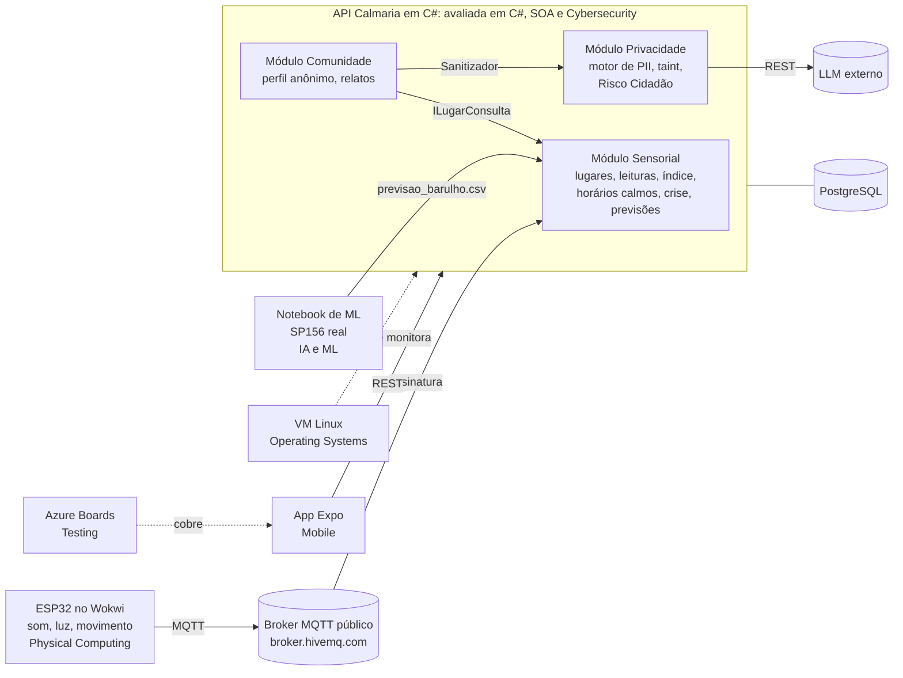

# Calmaria: escopo global

> **Nome provisório.** "Calmaria" é sugestão; trocar aqui e no README se a equipe preferir outro.
> Este documento é a fonte única do projeto: os arquivos de cada disciplina, em
> [disciplinas/](disciplinas/), partem dele e não o contradizem. Mudou algo aqui (um campo, um endpoint,
> uma regra)? Avise quem cuida das outras partes.
>
> **Os arquivos de cada disciplina são autossuficientes:** cada um traz o projeto, a parte da pessoa, os
> contratos com exemplos e um prompt pronto, para ser entregue inteiro à IA de quem vai fazer.

**Global Solution 2026.2, FIAP, Engenharia de Software, 3º ano.** Entrega de todas as disciplinas em
**19/11/2026, às 23h55**, cada uma na sua tarefa do Teams, enviada por um só integrante.

---

## 1. O problema

Para muitas pessoas autistas, barulho alto, luz forte e multidão não são incômodo: são gatilho de
**sobrecarga sensorial**, que pode virar crise (choro, fuga, paralisação, desligamento). Quem convive com
isso planeja cada saída: que horas o mercado está vazio, qual saída da estação tem menos gente, onde dá
para se recompor se a crise vier. Nenhum app de mapa mostra nada disso. O Google Maps diz se um lugar
"costuma estar cheio", mas não diz se é barulhento, se a luz é forte, nem onde fica o lugar silencioso
mais perto.

**O problema em uma frase:** pessoas autistas em São Paulo não têm como saber, antes de sair, se um mercado
ou uma estação vai estar barulhento, claro demais ou lotado, e quando a sobrecarga vem, não sabem onde fica
o lugar calmo mais próximo.

### Os números que sustentam o problema
- **2,4 milhões de brasileiros têm diagnóstico de autismo (1,2% da população)**, segundo o Censo 2022 do
  IBGE, a primeira contagem oficial, divulgada em 23/05/2025. Cerca de 43% estão no Sudeste.
- **São Paulo registra milhares de reclamações de barulho por trimestre.** Na base aberta do SP156, o
  assunto "Poluição Sonora - PSIU" teve **14.178 reclamações só no 3º trimestre de 2026** (de 484 mil
  solicitações), todas com latitude e longitude. **Sábado e domingo concentram o dobro dos dias úteis**
  (cerca de 2.950 cada, contra 1.376 na terça). **A Consolação, vizinha da FIAP Paulista, é o 2º distrito
  com mais reclamações** (541), atrás do Jardim São Luís (575). Contagem feita pela equipe sobre o arquivo
  "Dados do SP156 - 3º TRI 2026".
- **A lei já trata o autismo como deficiência:** a Lei 12.764/2012 (Lei Berenice Piana) considera a pessoa
  com TEA pessoa com deficiência para todos os efeitos legais, e a Lei 13.977/2020 (Lei Romeo Mion) criou a
  CIPTEA, a carteira de identificação, que a Prefeitura de São Paulo emite e publica no portal de dados
  abertos.

> Os números acima saíram de fontes públicas: a nota do IBGE (Agência de Notícias, Censo 2022, pessoas com
> TEA) e o portal https://dados.prefeitura.sp.gov.br (conjuntos "Dados do SP156 - Solicitações" e
> "Carteira de Identificação da Pessoa com TEA - CIPTEA"). Conferir e citar no README e no pitch.

---

## 2. O cidadão

**Quem:** a pessoa autista com hipersensibilidade sensorial, adolescente ou adulta, que circula sozinha pela
cidade, e o responsável por uma criança autista, que planeja as saídas da família.

**Onde:** São Paulo, região da Bela Vista e da Consolação (entorno da FIAP Paulista, Av. Paulista e Rua
Augusta). Se a equipe for da unidade Lins, trocar pelo entorno dela; a lógica não muda.

**Personas de trabalho** (fictícias, para orientar o design; a entrevista real está na seção 9):
- **Marina, 24 anos**, autista, trabalha na Paulista e usa a Linha 2 do metrô. Evita a estação no horário
  de pico e faz mercado só de manhã cedo. Quando a sobrecarga vem, precisa de um lugar quieto em menos de
  10 minutos.
- **Carla, 41 anos**, mãe do Theo, 8 anos, autista. Antes de sair, liga para o mercado perguntando se está
  cheio. Leva fone abafador, mas não sabe quais lugares têm "hora silenciosa".

---

## 3. A solução

A **Calmaria** é um mapa sensorial da cidade. Sensores medem som, luz e movimento de pessoas em lugares
como mercados e estações e calculam um **Índice de Sobrecarga Sensorial (ISS)**, de 0 a 100. O app mostra
esse índice no mapa, diz **quais horários costumam ser mais calmos** em cada lugar, avisa **em que dias a
região costuma ser mais barulhenta** (pela previsão feita com dados reais do SP156) e tem um **botão de
crise** que leva ao refúgio calmo mais próximo, mesmo sem internet. A comunidade completa o mapa com
**relatos** de como foi a visita.

### O que o cidadão consegue fazer (jornada principal)
1. Abre o app e informa, se quiser, o seu perfil sensorial: o quanto é sensível a som, luz e multidão
   (1 a 5) e um contato de apoio.
2. Vê no mapa os lugares perto dele, cada um com o nível atual em cor **e** em texto: Calmo, Moderado ou
   Intenso.
3. Abre um lugar e vê o índice agora (som, luz e movimento), os 3 horários mais calmos da semana, a
   previsão de barulho do distrito para os próximos dias e o que outras pessoas relataram.
4. Escolhe ir no horário calmo, ou vai a um lugar alternativo mais calmo, com o trajeto aberto no app de
   mapas do celular.
5. Se a sobrecarga vier, toca no **botão de crise** (sempre visível): a tela fica simples e escura, mostra
   o refúgio mais próximo com distância e direção, um roteiro de respiração em texto e um botão para ligar
   para o contato de apoio. Funciona offline, com os refúgios guardados no celular.
6. Depois, se quiser, relata como foi a visita: nota sensorial e o que incomodou.

### Princípios de design (valem para todas as partes)
- **Nada de som, vibração forte, flash nem animação** no app e no dispositivo. Um app para quem sofre com
  estímulo não pode ser mais um estímulo. O ESP32 não tem buzzer de propósito.
- **Cor nunca sozinha:** todo nível aparece em cor, em texto e com a letra e a forma (C no círculo, M no
  quadrado, I no losango).
- **Linguagem literal e curta.** Sem metáfora, sem ironia, sem jargão.
- **Previsível:** a mesma navegação em todas as telas; o botão de crise sempre no mesmo lugar.
- **Privacidade por padrão:** sem login no MVP (o app gera um identificador anônimo); o histórico de crises
  fica só no celular; dado de saúde nunca vai para log nem para o broker MQTT público.
- **Funciona com conexão ruim:** o botão de crise não depende da internet.

### Identidade visual
Calmaria é o mar sem vento: o símbolo são três linhas, da onda agitada à linha reta. A marca é um
azul-ardósia apagado, que nunca se confunde com os níveis. Toda peça da equipe usa só estas cores.

| Cor | Hex | Uso |
|---|---|---|
| Ardósia (a marca) | `#3D5A73` | Botões, links, logotipo, ícone do app, série principal dos gráficos |
| Fundo claro | `#F1F5F7` | Fundo das telas (nunca branco puro) |
| Cartão | `#F8FBFD` | Cartões, campos, fundo dos gráficos |
| Texto e fundo escuro | `#14191F` | Texto no tema claro; fundo no tema escuro |
| Apoio | `#4D545B` | Texto secundário, legendas, série "real" nos gráficos |
| Crise | `#1F2733` | Tela de crise, abertura e cartela final dos vídeos, banner, miniatura |
| Calmo | `#437E61` | Nível Calmo (C, círculo): ISS 0 a 39, previsão BAIXO, risco baixo, LED verde |
| Moderado | `#BBA15E` | Nível Moderado (M, quadrado): ISS 40 a 69, MEDIO, risco médio, LED amarelo; texto escuro por cima |
| Intenso | `#B2574D` | Nível Intenso (I, losango): ISS 70 a 100, ALTO, risco alto, LED vermelho |

- **Fonte:** Atkinson Hyperlegible Next para texto e Atkinson Hyperlegible Mono para números e código
  (Google Fonts, licença OFL; os arquivos estão em `design/pecas/fontes/`).
- **Cor só quando significa nível.** O resto do sistema é ardósia e neutros.
- **Quieto:** nada pisca nem anima, nem no LED; todo ícone vem com texto.
- Todas as combinações de texto e fundo passam no WCAG 2.2 AA, no tema claro e no escuro (conferido por script).

Especificação completa (telas do app, visor, painel, vídeos e a lista de 46 peças):
[design/plano-de-design.md](../design/plano-de-design.md) e `design/design-da-calmaria.html`. Peças prontas em
`design/pecas/png/`. Cada arquivo de disciplina tem a seção "Design da sua parte".

### Fora do escopo do protótipo
Roteamento a pé ponderado por barulho; microfone real (o potenciômetro simula); login com senha; sensores
reais instalados; publicação nas lojas de aplicativos.

---

## 4. Como as partes se encaixam



| Parte | Disciplina | O que faz na Calmaria | Arquivo |
|---|---|---|---|
| Dispositivo ESP32 | Physical Computing | Mede som, luz e movimento, calcula o ISS e publica por MQTT | [physical-computing.md](disciplinas/physical-computing.md) |
| API Calmaria, módulos Sensorial e Comunidade | C# Software Development | O núcleo: lugares, leituras, índice, horários calmos, botão de crise, previsões, perfil anônimo e relatos | [csharp.md](disciplinas/csharp.md) |
| A mesma API, pela rubrica de SOA | SOA e Web Services | Domínio, PostgreSQL, migrações, documentação automática, testes e a chamada REST ao LLM | [soa-web-services.md](disciplinas/soa-web-services.md) |
| API Calmaria, módulo Privacidade | Cybersecurity | Acha dado sensível, bloqueia vazamento, traduz o risco por IA e calcula o Risco Cidadão | [cybersecurity.md](disciplinas/cybersecurity.md) |
| Notebook de ML | IA e Machine Learning | Prevê o nível de barulho por distrito e dia com o SP156 real | [ia-machine-learning.md](disciplinas/ia-machine-learning.md) |
| App | Mobile Development e IoT | A porta de entrada do cidadão | [mobile.md](disciplinas/mobile.md) |
| VM Linux | Operating Systems | Sobe a API e o PostgreSQL sozinha, monitora, audita e aguenta falha | [operating-systems.md](disciplinas/operating-systems.md) |
| Qualidade | Testing, Compliance e QA | Features, critérios de aceite e test cases da solução inteira | [testing-qa.md](disciplinas/testing-qa.md) |
| Pitch | Testing (envio) | Vídeo de 4 minutos | seção 10 deste arquivo |

> **Uma API para três disciplinas (decisão de 12/11).** C#, SOA e Cybersecurity são entregues sobre a mesma
> API em C#, organizada em três módulos que só conversam por interface. Isso tira da semana uma segunda
> linguagem, um segundo banco e a integração entre serviços. **Confirmar com os professores de SOA e de
> Cybersecurity na sexta, 13/11.** Os planos B estão em [soa-web-services.md](disciplinas/soa-web-services.md)
> e [cybersecurity.md](disciplinas/cybersecurity.md).

---

## 5. Contratos entre as partes

Estes contratos são o que permite cada um trabalhar em paralelo. **Mudar um nome aqui exige avisar a
equipe.**

### 5.1 Índice de Sobrecarga Sensorial (ISS)
O mesmo cálculo no ESP32 (para o display) e na API .NET (o valor que vale).

```
som_norm = limita((somDb - 40) / (100 - 40), 0, 1)
luz_norm = limita((luzLux - 300) / (3000 - 300), 0, 1)
mov_norm = limita(movimentosMin / 30, 0, 1)
ISS      = arredonda(100 * (0,5 * som_norm + 0,25 * luz_norm + 0,25 * mov_norm))
```

| ISS | Nível | Cor | Texto no app |
|---|---|---|---|
| 0 a 39 | `CALMO` | verde | "Calmo agora" |
| 40 a 69 | `MODERADO` | amarelo | "Moderado agora" |
| 70 a 100 | `INTENSO` | vermelho | "Intenso agora" |

O som pesa o dobro porque é o gatilho mais citado. Os pesos e faixas são hipótese do protótipo: a
entrevista (seção 9) pode mudar, e a mudança vale para todas as partes.

### 5.2 Mensagem MQTT (ESP32 para API .NET)
- **Broker:** `broker.hivemq.com`, porta `1883` (público, sem senha; por isso nunca leva dado pessoal).
- **Tópico:** `calmaria/v1/lugares/{lugarId}/leituras`
- **Payload (JSON):**

```json
{
  "dispositivoId": "esp32-consolacao-01",
  "lugarId": 1,
  "somDb": 78.5,
  "luzLux": 1450,
  "movimentosMin": 12,
  "indice": 53,
  "nivel": "MODERADO"
}
```

A API carimba a data e hora de recebimento (`registradaEm`); o ESP32 não precisa de relógio.

### 5.3 API Calmaria, módulo Sensorial (porta 5080 em desenvolvimento; porta 80 na VM)
| Método | Rota | O que devolve |
|---|---|---|
| GET | `/api/lugares?lat=&lng=&raioM=&tipo=` | Lugares perto, com o ISS e o nível atuais |
| GET | `/api/lugares/{id}` | Um lugar com a última leitura |
| POST, PUT, DELETE | `/api/lugares`, `/api/lugares/{id}` | Cadastro de lugares |
| GET | `/api/lugares/{id}/leituras?desde=` | Histórico de leituras |
| POST | `/api/leituras` | Ingestão por HTTP (alternativa ao MQTT e usada nos testes) |
| GET | `/api/lugares/{id}/horarios-calmos` | ISS médio por dia da semana e hora, e as 3 janelas mais calmas |
| GET | `/api/crise/refugio-mais-proximo?lat=&lng=` | O refúgio mais perto, distância em metros e link de trajeto |
| GET | `/api/refugios` | Todos os refúgios (o app guarda para usar offline) |
| GET | `/api/previsoes/barulho?distrito=&dias=7` (ou `&data=`) | Reclamações previstas e nível do distrito nos próximos dias |
| POST | `/api/previsoes/importar` | Importa o CSV gerado pelo notebook |
| GET | `/health` | Saúde da API (usado pelo monitoramento da VM) |

### 5.4 API Calmaria, módulos Comunidade e Privacidade (mesma API, mesma porta)
| Método | Rota | O que faz |
|---|---|---|
| POST | `/api/usuarios` | Cria um usuário anônimo e devolve o `id` (UUID) |
| GET, PUT | `/api/usuarios/{id}/perfil-sensorial` | Lê e grava o perfil sensorial |
| DELETE | `/api/usuarios/{id}` | Apaga o usuário, o perfil e os relatos (direito de exclusão da LGPD) |
| POST | `/api/relatos` | Grava um relato; confere o lugar e passa o comentário pelo sanitizador, devolvendo o que foi removido |
| GET | `/api/relatos?lugarId=` | Relatos públicos de um lugar, sem identificar o autor |
| GET | `/api/lugares/{lugarId}/resumo-relatos` | Nota média e gatilhos mais citados |
| POST | `/api/privacidade/analisar` | Analisa um texto e devolve os achados mascarados (o app avisa antes de enviar) |
| POST | `/api/privacidade/varreduras` | Roda a varredura de PII em logs, relatos, mensagens MQTT e código (exige `X-Admin-Key`) |
| GET | `/api/privacidade/risco-cidadao`, `/achados`, `/fluxos` | O indicador, os achados e os fluxos bloqueados, para o painel em `/seguranca` (exigem `X-Admin-Key`) |

### 5.5 Saída do ML (notebook para API .NET)
Arquivo `ml/saida/previsao_barulho.csv`, UTF-8, separador vírgula:

```
distrito,data,reclamacoes_previstas,nivel
CONSOLACAO,2026-11-21,9.4,ALTO
CONSOLACAO,2026-11-24,4.1,MEDIO
```

`nivel` é `BAIXO`, `MEDIO` ou `ALTO`, pelos tercis do próprio distrito. Nome do distrito em maiúsculas e
sem acento, como na base do SP156; a API .NET guarda o mesmo nome no campo `Distrito` de cada lugar.

### 5.6 Modelo de dados comum

| Conceito | Módulo | Campos principais |
|---|---|---|
| Lugar | Sensorial | id, nome, tipo (`MERCADO`, `ESTACAO`, `PARQUE`, `REFUGIO`, `OUTRO`), latitude, longitude, endereço, distrito, éRefúgio, horário de funcionamento |
| Dispositivo | Sensorial | id (texto, ex. `esp32-consolacao-01`), lugarId, ativo, última leitura em |
| Leitura | Sensorial | id, dispositivoId, lugarId, somDb, luzLux, movimentosMin, ISS, nível, registradaEm |
| PrevisaoBarulho | Sensorial | distrito, data, reclamações previstas, nível |
| Usuario | Comunidade | id (UUID), apelido opcional, criado em |
| PerfilSensorial | Comunidade | sensibilidade a som, luz e multidão (1 a 5), nome e telefone do contato de apoio |
| Relato | Comunidade | id, usuário, lugar, nota sensorial (1 a 5), gatilhos (`BARULHO`, `LUZ_FORTE`, `MULTIDAO`, `CHEIRO`, `FILA`, `OUTRO`), comentário sanitizado, visitado em |
| Varredura, Achado, EventoDeFluxo | Privacidade | quando rodou, regra, categoria, peso, trecho mascarado, origem, destino, bloqueado |

### 5.7 Lugares do protótipo (seed)
Lugares reais da região; as **leituras são simuladas** e isso aparece no README.

| id | Lugar | Tipo | Distrito provável (conferir) |
|---|---|---|---|
| 1 | Estação Consolação (Linha 2) | ESTACAO | CONSOLACAO |
| 2 | Estação Paulista (Linha 4) | ESTACAO | CONSOLACAO |
| 3 | Estação Trianon-Masp (Linha 2) | ESTACAO | BELA VISTA |
| 4 | Um supermercado da Rua Augusta (escolher na observação) | MERCADO | CONSOLACAO |
| 5 | Parque Trianon | REFUGIO | BELA VISTA |
| 6 | Casa das Rosas | REFUGIO | BELA VISTA |
| 7 | Um refúgio escolhido na observação (biblioteca, igreja, sala silenciosa) | REFUGIO | (preencher) |

Conferir na observação (seção 9) o distrito oficial de cada endereço e se os refúgios estão abertos nos
horários do teste.

---

## 6. Tecnologias

| Parte | Stack | Por quê |
|---|---|---|
| API Calmaria | .NET 10, ASP.NET Core Web API, EF Core com PostgreSQL (Npgsql), LINQ, MQTTnet, Scalar (OpenAPI), MSTest | A base do CP2 de C#; uma API só para C#, SOA e Cybersecurity; PostgreSQL pesa mais em SOA |
| App | Expo com React Native e TypeScript, Expo Router, expo-sqlite, expo-location, react-native-maps | O que a disciplina pede |
| ESP32 | Wokwi, Arduino (C++), PubSubClient, ArduinoJson, display SSD1306 | Roda no navegador e fala MQTT com o mundo real |
| ML | Python, pandas, scikit-learn, XGBoost, matplotlib, Jupyter | Os modelos da lista da disciplina |
| Infra | Ubuntu Server LTS numa VM, Bash, systemd, nginx, auditd | O que a disciplina pede |
| Segurança | Módulo `Calmaria.Privacidade` em C#, Semgrep em modo taint, um LLM chamado por REST, painel em HTML com Chart.js servido pela API | Ver [cybersecurity.md](disciplinas/cybersecurity.md) |
| Qualidade | Azure DevOps (Boards) | O que a disciplina pede |

---

## 7. O repositório

Um repositório só, uma pasta por parte, como o briefing pede ("Repositório organizado: README claro, uma
pasta para cada parte"). Cada disciplina envia o link do repositório e aponta a pasta dela.

```
calmaria/
├── README.md              Ficha da CitizenTech, visão geral, como rodar, integrantes
├── prompts.md             Os prompts de IA usados (exigência do briefing)
├── docs/                  Este escopo, os arquivos das disciplinas, fotos e notas da observação e da entrevista
├── api-dotnet/            A API: C#, SOA e o módulo de Cybersecurity (src/Calmaria.Privacidade)
├── mobile/                App Expo
├── iot/                   ESP32: sketch, diagram.json, libraries.txt, link do Wokwi
├── ml/                    Notebook, dados/README.md, requirements.txt, RELATORIO_ML.md
├── infra/                 Scripts Bash, units do systemd, configurações da VM
├── security/              Regras do Semgrep, exemplos, relatórios, evidências e o script do ZIP de Cybersecurity
└── qa/                    PDF do Azure Boards e os prints
```

> **Confirmar com os professores** se o link de um repositório único serve para todas as disciplinas. Se
> algum exigir repositório só da parte dele, criar um repositório separado a partir da pasta.

---

## 8. A Ficha da CitizenTech

Vai no topo do README (o briefing pede) e no README do app (Mobile pede).

| Campo | Resposta |
|---|---|
| Nome da CitizenTech | Calmaria (provisório) |
| Cidade e bairro | São Paulo, Bela Vista e Consolação |
| Cidadão beneficiado | Pessoas autistas com hipersensibilidade sensorial e as famílias que planejam as saídas delas |
| Problema, em uma frase | Pessoas autistas não têm como saber, antes de sair, se um mercado ou uma estação vai estar barulhento, claro demais ou lotado, nem onde fica o lugar calmo mais próximo quando a sobrecarga vem |
| Como funciona | Sensores calculam um índice de sobrecarga de cada lugar; o app mostra o índice, os horários mais calmos e a previsão de barulho da região, e tem um botão de crise que leva ao refúgio calmo mais próximo, mesmo offline |
| O que cada parte faz | O ESP32 mede; a API em C# guarda, calcula, recebe os relatos e protege o dado de saúde com o módulo de privacidade; o ML prevê o barulho com o SP156; o app mostra; a VM hospeda e monitora; o Azure Boards garante a qualidade |
| Link do repositório | (preencher) |
| Indicador de impacto | Tempo do toque no botão de crise até a chegada ao refúgio (meta: menos de 10 minutos a pé) e a parcela das visitas feitas em horário calmo |
| ODS conectados | 3 (meta 3.4), 10 (meta 10.2) e 11 (metas 11.2 e 11.7) |

### As seis perguntas do briefing
1. **Quem é o cidadão beneficiado?** Seção 2.
2. **Qual problema será resolvido?** Seção 1.
3. **Como a solução funcionará?** Seção 3.
4. **Quais tecnologias serão empregadas?** Seção 6.
5. **Quem participará do ecossistema?** A pessoa autista e a família (usam e relatam); estabelecimentos e
   operadores de transporte (podem instalar o sensor e criar "horas silenciosas"); associações de apoio a
   pessoas autistas (validam e divulgam); a Prefeitura (dados abertos do SP156 e políticas para a pessoa com
   deficiência); a comunidade, que alimenta os relatos.
6. **Como o impacto será medido e ampliado?** Indicadores da seção 8. Para ampliar: mais sensores em
   estações e mercados parceiros, um selo "lugar amigo do autista" para quem mantém o índice baixo, e o mapa
   aberto para outros públicos sensíveis a estímulo (pessoas com TDAH, enxaqueca, idosos com demência).

### Indicadores de impacto
| Indicador | Como medir no protótipo | Meta |
|---|---|---|
| Tempo até o refúgio | Do toque no botão de crise até o refúgio, pela distância a pé devolvida pela API | Menos de 10 minutos |
| Visitas em horário calmo | Visitas registradas nos relatos dentro das janelas calmas sugeridas | Mais da metade |
| Cobertura | Lugares da região com índice ativo | Os 7 do seed |
| Utilidade percebida | Pergunta depois da crise: "O refúgio ajudou?" | Mais de 70% sim |

### ODS
- **ODS 3, Saúde e bem-estar, meta 3.4:** promover a saúde mental e o bem-estar. Menos exposição a gatilho
  e um caminho rápido para se recompor reduzem crises.
- **ODS 10, Redução das desigualdades, meta 10.2:** inclusão social de todos, independentemente de
  deficiência. A cidade passa a ser legível para quem processa estímulo de outro jeito.
- **ODS 11, Cidades e comunidades sustentáveis, metas 11.2 e 11.7:** transporte acessível e espaços
  públicos seguros, inclusivos e acessíveis, em especial para pessoas com deficiência.

---

## 9. Observar e escutar (etapas 1 e 2 do briefing)

O briefing exige um problema visto de perto e **uma conversa com quem convive com ele**. Isso entra no
README e no pitch e pesa na "aderência ao problema" de várias disciplinas.

### Observação (1 a 2 horas, em dupla)
- Visitar a Estação Consolação e um mercado da Augusta em dois horários (pico e vale) e um refúgio.
- Registrar: fotos do lugar (sem rosto de pessoas), o som com um app medidor de decibéis no celular, se a
  luz é fria ou forte, a lotação e se há lugar para sentar e se recompor.
- Salvar em `docs/observacao/` com data, hora e o que foi medido. Esses números calibram as faixas do ISS.

### Entrevista (20 a 30 minutos)
Com uma pessoa autista adulta ou o responsável por uma criança autista. Pode ser alguém da família, um
colega, um grupo de pais ou uma associação. Pedir consentimento para usar as respostas e **não registrar
nome, idade exata nem diagnóstico detalhado**: no README, "Entrevistada A, adulta autista".

Roteiro:
1. Como você decide se vai a um lugar movimentado, como mercado ou estação?
2. O que mais incomoda: barulho, luz, multidão, cheiro, fila? Em que ordem?
3. Conte uma vez em que a sobrecarga veio fora de casa. O que você fez? O que teria ajudado?
4. Hoje, como você descobre o horário mais vazio de um lugar?
5. Se um app mostrasse o nível de barulho de um lugar, você confiaria? O que faria você confiar?
6. Num momento de crise, o que o celular deveria mostrar? E o que ele nunca deveria fazer?
7. Você contaria para um app que é autista? O que acontece se esse dado vazar?
8. Que lugar perto daqui você considera um refúgio?

Salvar o resumo em `docs/entrevista.md`. As respostas 2, 6 e 7 decidem os pesos do ISS, o desenho do botão
de crise e o discurso de privacidade do pitch.

---

## 10. O pitch (prêmio de melhor GS)

Vídeo de até 4 minutos no YouTube, link enviado na disciplina de Testing.

| Tempo | O que mostrar |
|---|---|
| 0:00 a 0:30 | A frase da entrevista sobre a crise, a foto da estação e o número do Censo |
| 0:30 a 0:50 | O problema em uma frase e quem é o cidadão |
| 0:50 a 2:30 | A demo de ponta a ponta: o potenciômetro sobe no Wokwi, o lugar fica "Intenso" no app, os horários calmos, a previsão de barulho do sábado, o botão de crise levando ao Parque Trianon |
| 2:30 a 3:20 | Como foi construído: as 8 partes em um diagrama, o dado de saúde protegido, a VM subindo sozinha |
| 3:20 a 4:00 | Indicadores, ODS e o que vem depois |

Todo integrante aparece ou narra uma parte; o briefing cobra que todos saibam explicar o projeto inteiro.

---

## 11. Divisão da equipe

| Quem | Disciplinas | Parte | Arquivo |
|---|---|---|---|
| Luiz | C# Software Development, SOA e Web Services, Cybersecurity | A API Calmaria inteira, com os três módulos | [csharp.md](disciplinas/csharp.md), [soa-web-services.md](disciplinas/soa-web-services.md), [cybersecurity.md](disciplinas/cybersecurity.md) |
| Integrante 2 | Mobile Development e IoT | O app Expo | [mobile.md](disciplinas/mobile.md) |
| Integrante 3 | IA e Machine Learning | O notebook com o SP156 e o CSV de previsões | [ia-machine-learning.md](disciplinas/ia-machine-learning.md) |
| Integrante 4 | Operating Systems; Testing, Compliance e QA | A VM Linux que sobe a API e o PostgreSQL; o Azure Boards e o PDF | [operating-systems.md](disciplinas/operating-systems.md), [testing-qa.md](disciplinas/testing-qa.md) |
| Integrante 5 | Physical Computing, e o pitch | O ESP32 no Wokwi; a montagem e a publicação do pitch | [physical-computing.md](disciplinas/physical-computing.md) |

**Por que assim (revisto em 12/11).** O Luiz ficou com as três disciplinas que a mesma API atende. O Integrante 4
já tinha feito Operating Systems e Testing, então ficou com as duas. As outras três disciplinas ficaram uma
por pessoa: App e ML, as maiores, e Physical Computing, a mais leve, que leva junto o pitch, porque quem monta
o sensor conhece a demo que o pitch mostra. O link do pitch vai na entrega de Testing, pelo Integrante 4.

**Carga.** A do Luiz é a maior. Se apertar, o primeiro pedaço a passar adiante é a evidência estática do Semgrep
(Cybersecurity), que o Integrante 5 consegue fazer a partir de quarta.

A observação do lugar e a entrevista (seção 9) são de todos: no fim de semana, quem estiver na região vai.

---

## 12. Cronograma até 19/11

| Dia | O que fica pronto |
|---|---|
| Qui 12/11 | Equipe e divisão fechadas; repositório e projeto do Azure DevOps criados; entrevista marcada; todos leram este escopo |
| Sex 13/11 (última aula com foco na GS) | Dúvidas levadas aos professores (seção 13); Ficha revisada |
| Sáb 14 e Dom 15 | Observação e entrevista; API com lugares, leituras e MQTT; módulos Comunidade e Privacidade com domínio, regras, testes e migrações; ESP32 publicando; dados do SP156 baixados e filtrados; app navegando com dados mockados; features no Azure Boards |
| Seg 16 e Ter 17 (orientação) | App ligado à API; previsões importadas; VM provisionando a API e o PostgreSQL; varreduras, IA e painel de privacidade; Semgrep; test cases |
| Qua 18 | Funcionalidades congeladas às 20h; vídeos gravados (ML, Mobile, OS, ESP32, Cybersecurity); PDF de Testing |
| Qui 19 | Pitch gravado; READMEs revisados; **todos os envios feitos até 21h**, deixando 3 horas de margem antes das 23h55 |

Regra da equipe: **o básico funcionando antes de qualquer extra.** Cada arquivo de disciplina separa o
obrigatório do opcional.

---

## 13. Dúvidas para levar aos professores (sexta, 13/11)

- **SOA:** a entrega pode ser a mesma API em C# da disciplina de C#? (Plano B em
  [soa-web-services.md](disciplinas/soa-web-services.md).)
- **Cybersecurity:** qual é o "motor de parsing" e o "dashboard" que o slide manda atualizar? Existe uma base
  da aula? O módulo pode viver dentro da API em C#?
- **Todas:** o link de um repositório único com uma pasta por parte serve?
- **Physical Computing:** qual é a rubrica?
- **Mobile:** ler a rubrica completa na tarefa do Teams e conferir com a seção de critérios do arquivo.

---

## 14. Regras do briefing que valem para todas as partes

- **IA como copiloto, com registro:** todo prompt relevante vai para `prompts.md` com a data, a parte e o
  que foi aproveitado. Cada um sabe explicar cada linha que entregou.
- **Dados com cuidado:** nada de dado pessoal real. Usuários e relatos de teste são inventados e marcados
  como tal; as leituras dos sensores são simuladas e o README diz isso; o ML usa o SP156 real, que não tem
  dado pessoal do reclamante.
- **Todo mundo constrói** e todo mundo sabe explicar o projeto inteiro.
- **Um envio por disciplina**, feito por um só integrante, até 19/11 às 23h55.
