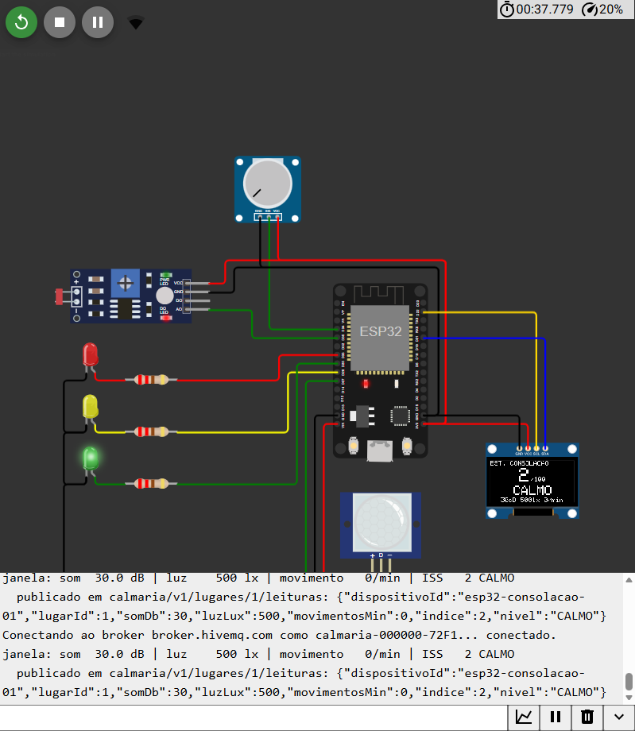
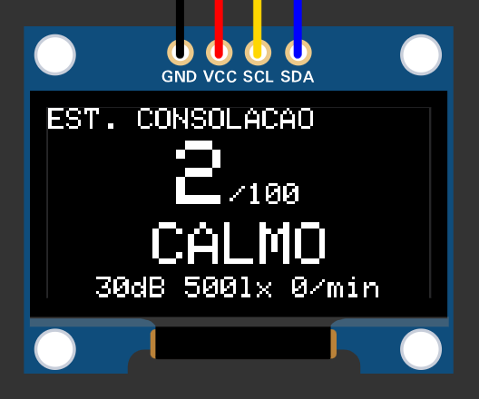
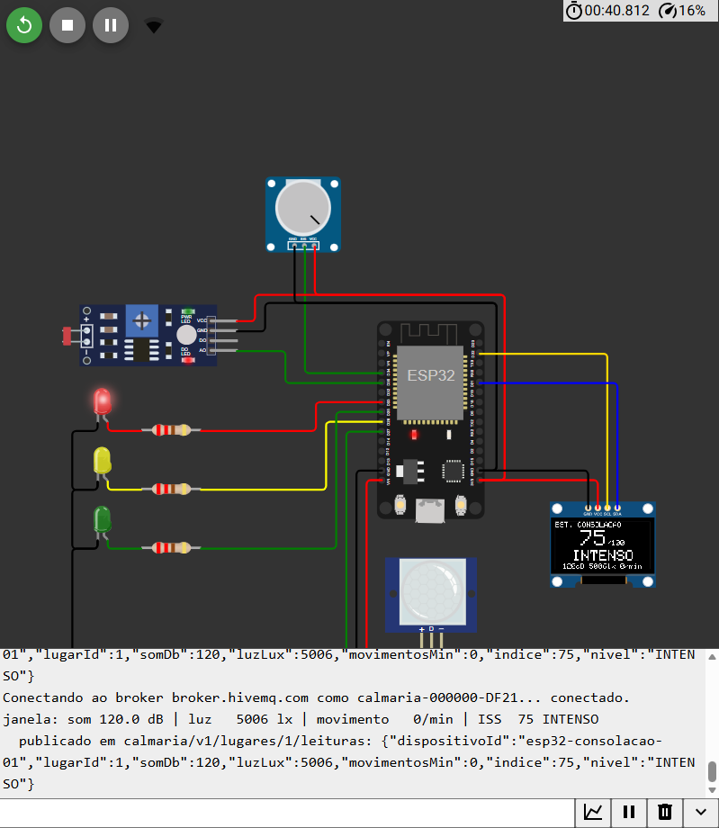
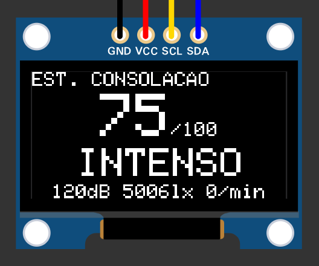
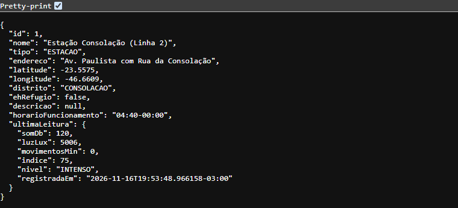
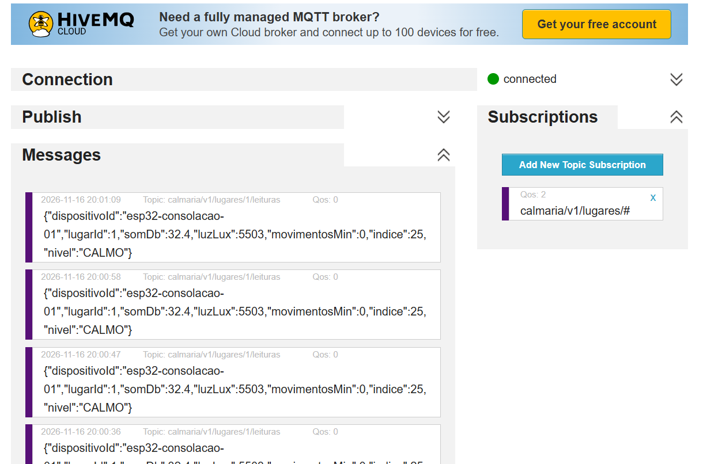

# Sensor da Calmaria: ESP32 no Wokwi

A parte de **Physical Computing (IoT e IoB)** da Calmaria. O ESP32 fica num mercado ou numa estação, mede som,
luz e movimento de pessoas, calcula o Índice de Sobrecarga Sensorial (ISS), mostra o nível no próprio lugar
(visor e LED) e publica a leitura por MQTT. A API da Calmaria recebe, grava e o app mostra o lugar no mapa com a
cor do nível. Sem este sensor, o mapa só teria os dados simulados do seed.

**As leituras são simuladas:** o potenciômetro faz o papel do microfone, o fotoresistor mede a luz no
controle deslizante do Wokwi e o PIR detecta movimento quando a gente clica nele.

| | |
|---|---|
| Projeto no Wokwi | https://wokwi.com/projects/480806758336429057 |
| Vídeo | https://youtu.be/fdnAx1fj3zc |
| Plano da disciplina | [docs/disciplinas/physical-computing.md](../docs/disciplinas/physical-computing.md) |
| Integrantes | [integrantes.txt](integrantes.txt) |

## Arquivos

| Arquivo | O que é |
|---|---|
| `sketch.ino` | O firmware, em Arduino (C++) |
| `diagram.json` | O circuito, exportado do Wokwi |
| `libraries.txt` | As bibliotecas que o Wokwi instala: PubSubClient, ArduinoJson, Adafruit SSD1306 e Adafruit GFX |
| `integrantes.txt` | Nome e RM dos integrantes |
| `prints/` | Prints do circuito em CALMO e em INTENSO, do visor, da resposta da API e do cliente MQTT |

## O que o aparelho faz

```
a cada 1 segundo:  lê o som e a luz; o PIR é conferido a cada volta do loop
a cada 5 segundos: tira as médias, conta os movimentos por minuto, calcula o ISS,
                   atualiza o visor e o LED e publica a leitura por MQTT
```

- **Sem buzzer, de propósito.** Um aparelho para quem sofre com barulho não apita. Os LEDs ficam com brilho
  baixo (PWM 40 de 255), um aceso por vez, sem piscar.
- **Continua medindo sem internet.** Se o Wi-Fi ou o broker cair, o visor segue mostrando o índice, avisa na
  última linha e o aparelho tenta reconectar a cada 5 segundos.
- **Nenhum dado de pessoa sai do aparelho.** O broker é público e qualquer pessoa pode assinar o tópico, então a
  mensagem leva só medidas do ambiente.
- Na demonstração a janela é de 5 segundos; num lugar real seria de 1 minuto (`INTERVALO_JANELA_MS`).

## Peças

| Peça no Wokwi | Id no `diagram.json` | O que faz | Pino do ESP32 |
|---|---|---|---|
| ESP32 DevKit (`wokwi-esp32-devkit-v1`) | `esp` | Controla tudo | |
| Potenciômetro (`wokwi-potentiometer`) | `potSom` | Simula o microfone: nível de som | GPIO 34 |
| Sensor de luz (`wokwi-photoresistor-sensor`) | `ldrLuz` | Luz, em lux | GPIO 35 |
| Sensor de presença (`wokwi-pir-motion-sensor`) | `pirMov` | Movimento de pessoas, como aproximação da lotação | GPIO 27 |
| Visor OLED 128 x 64 (`board-ssd1306`, I2C `0x3C`) | `oled` | Lugar, índice, nível e medidas | SDA GPIO 21, SCL GPIO 22 |
| LED verde e resistor de 220 ohms | `ledVerde`, `rVerde` | Nível CALMO | GPIO 25 |
| LED amarelo e resistor de 220 ohms | `ledAmarelo`, `rAmarelo` | Nível MODERADO | GPIO 26 |
| LED vermelho e resistor de 220 ohms | `ledVermelho`, `rVermelho` | Nível INTENSO | GPIO 33 |

## Ligações

| De | Para | Fio |
|---|---|---|
| Potenciômetro SIG | ESP32 D34 | verde |
| Potenciômetro VCC e GND | ESP32 3V3 e GND | vermelho e preto |
| Sensor de luz AO | ESP32 D35 | verde |
| Sensor de luz VCC e GND | ESP32 3V3 e GND | vermelho e preto |
| PIR OUT | ESP32 D27 | verde |
| PIR VCC e GND | ESP32 VIN e GND | vermelho e preto |
| Visor SDA e SCL | ESP32 D21 e D22 | azul e dourado |
| Visor VCC e GND | ESP32 3V3 e GND | vermelho e preto |
| ESP32 D25, D26 e D33 | Resistor de 220 ohms e ânodo do LED verde, amarelo e vermelho | na cor do LED |
| Cátodo dos três LEDs | GND | preto |

**Por que GPIO 34 e 35 para som e luz:** com o Wi-Fi ligado, os pinos analógicos do ADC2 do ESP32 param de
funcionar. Os dois sensores analógicos ficam no ADC1 (GPIO 32 a 39). GPIO 34 e 35 são só de entrada, o que basta
para eles.

## Do sinal ao número

| Medida | Como o sketch calcula |
|---|---|
| Som (dB) | `30 + leitura / 4095 * 90`: potenciômetro no mínimo é 30 dB, no máximo é 120 dB |
| Luz (lux) | O módulo é um divisor de tensão (resistor de 10 kOhm e o LDR). O sketch acha a resistência do LDR pela tensão em AO e converte para lux com os atributos da peça (`gamma` 0,7 e `rl10` 50), a mesma conta da documentação do Wokwi |
| Movimentos por minuto | Cada vez que a saída do PIR sobe de LOW para HIGH conta uma detecção; no fim da janela, `detecções * 60000 / duração da janela em ms` |

O ISS usa a fórmula combinada com a API (as constantes ficam no topo do `sketch.ino`; se a equipe mudar a
fórmula, muda nos dois lugares):

```
som_norm = limita((somDb  - 40)  / (100  - 40),  0, 1)
luz_norm = limita((luzLux - 300) / (3000 - 300), 0, 1)
mov_norm = limita(movimentosMin / 30, 0, 1)
ISS      = arredonda(100 * (0,5 * som_norm + 0,25 * luz_norm + 0,25 * mov_norm))
```

| ISS | Nível | LED |
|---|---|---|
| 0 a 39 | `CALMO` | verde |
| 40 a 69 | `MODERADO` | amarelo |
| 70 a 100 | `INTENSO` | vermelho |

O som pesa o dobro porque é o gatilho mais citado.

## A mensagem MQTT

- **Broker:** `broker.hivemq.com`, porta 1883, sem senha. O `clientId` é `calmaria-` com o final do MAC e um
  número sorteado, para não derrubar outra conexão com o mesmo nome.
- **Keepalive de 60 segundos**, e não os 15 do padrão do PubSubClient. O ESP32 conta esse tempo no relógio da
  simulação e o broker conta no tempo real; com o Wokwi a 20% da velocidade, 5 segundos de janela viram 25 reais,
  e com 15 segundos o broker derrubava a conexão entre uma publicação e outra.
- **Tópico:** `calmaria/v1/lugares/1/leituras` (o `1` vem de `LUGAR_ID`).
- **Payload**, a cada 5 segundos:

```json
{
  "dispositivoId": "esp32-consolacao-01",
  "lugarId": 1,
  "somDb": 78.5,
  "luzLux": 1450,
  "movimentosMin": 12,
  "indice": 53,
  "nivel": "MODERADO"
}
```

O `indice` e o `nivel` são informativos: a API recalcula com a mesma fórmula e carimba a data e a hora de
recebimento, então o ESP32 não precisa de relógio. O `dispositivoId` precisa estar cadastrado na API.

## O visor

| Tela | Quando aparece | O que mostra |
|---|---|---|
| Inicializando | Ao ligar | O símbolo da Calmaria em pixels, `CALMARIA` e `CONECTANDO WI-FI` ou `CONECTANDO MQTT` |
| Sem dado | Antes da primeira janela fechar | `SEM DADO` e `AGUARDANDO LEITURA` |
| Medindo | A cada 5 segundos | `EST. CONSOLACAO`, o índice grande com `/100`, o nível e as medidas, como `88dB 2300lx 12/min` |
| Sem conexão | Wi-Fi ou broker fora | A mesma tela de medição, com `SEM WI-FI: SO VISOR` ou `SEM MQTT. SO NO VISOR` na última linha |

O visor é redesenhado inteiro a cada janela: o número troca e nada pisca nem anima. Os textos são sem acento
porque a fonte do visor não tem.

## Como testar

1. **No Wokwi.** Abra o projeto pelo link acima e inicie a simulação. Em alguns segundos o visor sai da tela de
   inicialização, e o monitor serial mostra uma linha por janela:
   `janela: som  32.4 dB | luz   5503 lx | movimento   0/min | ISS  25 CALMO`, seguida de
   `publicado em calmaria/v1/lugares/1/leituras: {...}`.
2. **Mexa nos sensores** e veja o índice, o nível e o LED mudarem na janela seguinte:
   - potenciômetro (som) no mínimo e luz baixa: `CALMO`, LED verde;
   - potenciômetro no máximo e luz baixa (até 300 lux): o som sozinho soma 50 pontos, `MODERADO`, LED amarelo;
   - potenciômetro no máximo e luz acima de 3.000 lux: 75 pontos, `INTENSO`, LED vermelho, mesmo sem movimento;
   - clicar no PIR durante a simulação conta um movimento e soma pontos ao índice.

   A luz do monitor serial bate com o controle deslizante do sensor de luz: 500 lux no controle dão 500 lux no
   serial, e 5.012 lux no controle dão 5.006.
3. **Ver a mensagem sem a API.** Num cliente MQTT (MQTT Explorer ou o cliente web da HiveMQ), conecte em
   `broker.hivemq.com:1883` e assine `calmaria/v1/lugares/#`. Cada janela aparece como uma mensagem nova.
4. **Ponta a ponta com a API.** Suba a API como explica o [README da API](../api-dotnet/README.md). Ela assina o
   mesmo tópico e grava cada leitura. Confira em `GET http://localhost:5080/api/lugares/1` (a última leitura) e
   em `GET http://localhost:5080/api/lugares/1/leituras` (o histórico).

**Teste ponta a ponta de 16/11/2026.** Com a API rodando num computador da equipe e a simulação no Wokwi, chegaram
9 leituras do `esp32-consolacao-01` em cerca de 1 minuto, todas gravadas e devolvidas por
`/api/lugares/1/leituras` (som 32,4 dB, luz 5.503 lux, 0 movimentos por minuto, ISS 25, `CALMO`). Elas chegaram a
cada 13 a 15 segundos, e não a cada 5, porque o Wokwi roda abaixo da velocidade real (entre 13% e 25% nos
prints abaixo; o simulador mostra a porcentagem no canto da simulação). Os 5 segundos da janela são contados no
tempo simulado. No mesmo dia, com o potenciômetro no máximo e a luz em cerca de 5.000 lux, a leitura `INTENSO`
(índice 75) também chegou à API (ver os prints abaixo).

## Prints

Tirados em 16/11/2026 no projeto público do Wokwi, com a API rodando num computador da equipe.

**CALMO.** Potenciômetro no mínimo (30 dB) e luz em 500 lux: índice 2, LED verde aceso. No monitor serial, cada
janela publicada em `calmaria/v1/lugares/1/leituras`.





**INTENSO.** Potenciômetro no máximo (120 dB) e luz em cerca de 5.000 lux: índice 75, LED vermelho aceso.





**A leitura chegou na API.** `GET http://localhost:5080/api/lugares/1` logo depois: a última leitura do lugar 1 é
a mesma que o ESP32 publicou (120 dB, 5.006 lux, índice 75, `INTENSO`), recebida por MQTT.



**A mensagem no broker.** O cliente web da HiveMQ conectado ao `broker.hivemq.com` e assinando
`calmaria/v1/lugares/#`: cada janela do ESP32 chega como uma mensagem no tópico `calmaria/v1/lugares/1/leituras`,
com o JSON do contrato.



## Do protótipo para a vida real

- O potenciômetro vira um microfone de verdade, como o MAX4466 ou o INMP441, com a média calculada no próprio
  ESP32: o áudio nunca sai do aparelho, só o nível em dB.
- A janela passa de 5 segundos para 1 minuto, o que reduz o tráfego e suaviza os picos.
- Um aparelho por lugar monitorado, cada um com o seu `LUGAR_ID` e `DISPOSITIVO_ID` cadastrados na API, em
  estações e mercados parceiros.
- Fora do protótipo, o broker deixa de ser público: com usuário e senha por aparelho e TLS na porta 8883.
